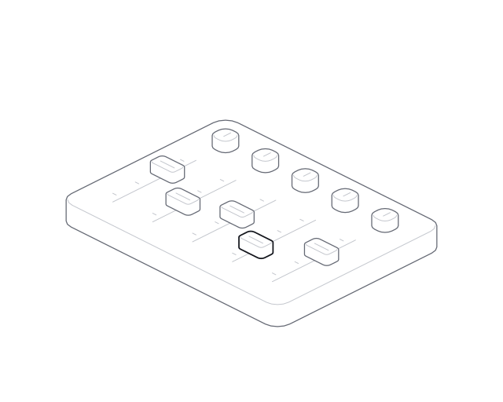
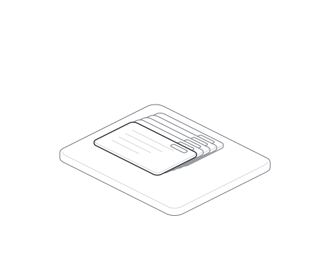
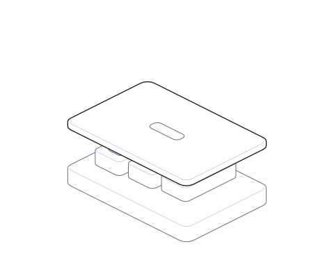

<a href="https://rambabu-143.github.io/My-portfolio/">
  <picture>
    <source media="(prefers-color-scheme: dark)" srcset="assets/profile-hero-dark.svg" />
    
  </picture>
</a>

  <a href="https://rambabu-143.github.io/My-portfolio/">Explore portfolio ↗</a> &nbsp; / &nbsp;
  <a href="https://www.linkedin.com/in/rambabuarabandi/">LinkedIn</a> &nbsp; / &nbsp;
  <a href="mailto:rambabuarabandi2001@gmail.com">Email me</a>

## Building from idea to production

I'm **Rambabu**, an AI Engineer with a full-stack background. I build voice agents, MCP developer tools, and retrieval workflows — from API integration and orchestration to evaluation and deployment.

**500+ daily calls** on a production voice agent. **End to end**, from the first integration to AI evaluation.

## Selected work

<table>
  <tr>
    <td align="center" width="33%">
      <a href="https://rambabu-143.github.io/My-portfolio/work/zaya-voice-ai-agent/">
        <picture>
          <source media="(prefers-reduced-motion: reduce) and (prefers-color-scheme: dark)" srcset="assets/voice-console-dark.svg" />
          <source media="(prefers-reduced-motion: reduce)" srcset="assets/voice-console-light.svg" />
          <source media="(prefers-color-scheme: dark)" srcset="assets/voice-console-dark.gif" />
          
        </picture>
         <strong>Zaya ↗</strong>
      </a>
    </td>
    <td align="center" width="33%">
      <a href="https://rambabu-143.github.io/My-portfolio/work/graphrag-knowledge-retrieval/">
        <picture>
          <source media="(prefers-reduced-motion: reduce) and (prefers-color-scheme: dark)" srcset="assets/documents-dark.svg" />
          <source media="(prefers-reduced-motion: reduce)" srcset="assets/documents-light.svg" />
          <source media="(prefers-color-scheme: dark)" srcset="assets/documents-dark.gif" />
          
        </picture>
         <strong>GraphRAG ↗</strong>
      </a>
    </td>
    <td align="center" width="33%">
      <a href="https://rambabu-143.github.io/My-portfolio/work/mcp-server-cli/">
        <picture>
          <source media="(prefers-reduced-motion: reduce) and (prefers-color-scheme: dark)" srcset="assets/server-kit-dark.svg" />
          <source media="(prefers-reduced-motion: reduce)" srcset="assets/server-kit-light.svg" />
          <source media="(prefers-color-scheme: dark)" srcset="assets/server-kit-dark.gif" />
          
        </picture>
         <strong>MCP Server CLI ↗</strong>
      </a>
    </td>
  </tr>
</table>

| Project | What I built | Stack |
| :--- | :--- | :--- |
| **[Zaya](https://rambabu-143.github.io/My-portfolio/work/zaya-voice-ai-agent/)** · Production | Real-time voice agent handling **500+ dealership calls daily**, with tool calling, turn management, and human fallback. | Python · LiveKit Agents · Sarvam AI · FastAPI |
| **[GraphRAG Knowledge Retrieval](https://rambabu-143.github.io/My-portfolio/work/graphrag-knowledge-retrieval/)** · Enterprise | Contributed to a pipeline combining vector search and graph traversal across related documents, evaluated with RAGAS and DeepEval. | GraphRAG · Vector search · RAGAS · DeepEval |
| **[MCP Server CLI](https://rambabu-143.github.io/My-portfolio/work/mcp-server-cli/)** · Internal tooling | Go CLI generating runnable MCP server projects with tool registration and configuration wiring. | Go · MCP · DeepEval |

[Explore the case studies on my portfolio ↗](https://rambabu-143.github.io/My-portfolio/#projects)

## Recent projects

| Project | What it does | Explore |
| :--- | :--- | :--- |
| **Class Quality Assessor** | Local class-recording assessment with transcript evidence, speaker signals, and coaching summaries. | [GitHub ↗](https://github.com/rambabu-143/Humaniti-Task) |
| **Survival Royale** | Browser-based 3D survival game with a shrinking zone, looting, and vehicle gameplay. Built with Babylon.js and Next.js. | [GitHub ↗](https://github.com/rambabu-143/survival-royale) |
| **Trending AI Post** | Finds trending repos and articles, summarizes them with Ollama, and publishes to LinkedIn. | [GitHub ↗](https://github.com/rambabu-143/Trending-AI-Post) |
| **My Portfolio** | Interactive AI engineering case studies, Hairline figures, and production project walkthroughs. | [Live ↗](https://rambabu-143.github.io/My-portfolio/) · [GitHub ↗](https://github.com/rambabu-143/My-portfolio) |

**Also shipped:** Hello Gorgeouss — [App Store ↗](https://apps.apple.com/in/app/hello-gorgeouss/id6739887399) · [Google Play ↗](https://play.google.com/store/apps/details?id=com.hellogorgeous).

## Tools I work with

| Area | Technologies |
| :--- | :--- |
| AI & agents | Tool calling · Agent orchestration · Structured outputs · Guardrails · LangChain · LangGraph · Vercel AI SDK |
| Tooling & automation | MCP servers · Go CLI tooling · n8n · Webhooks · Event-based orchestration |
| Voice AI | LiveKit Agents · Sarvam AI · Real-time STT/TTS · Turn management |
| Retrieval & evaluation | GraphRAG · BM25 · Vector search · FalkorDB · RRF · Cross-encoder reranking · RAGAS · DeepEval |
| Full-stack | Python · TypeScript · JavaScript · Go · FastAPI · Node.js/Express · Next.js · React · Tailwind CSS |
| Data & cloud | PostgreSQL · MongoDB · Supabase · AWS · GCP · Docker · Vercel · Git |

## Experience

- **Arohak Inc. · AI Engineer** — Mar–Sep 2026 
  Johnson & Johnson engagement via Cognizant. MCP developer tooling, GraphRAG retrieval, and unattended n8n automation.
- **Cyepro Solutions · Generative AI Engineer, Contract** — Jul 2025–Feb 2026 
  Architected and shipped Zaya, with real-time voice orchestration and dealership API integrations.
- **Ordermatic Technologies · Software Development Engineer** — Apr 2024–Apr 2025 
  Full-stack features across billing, CRM, and inventory for a live restaurant POS.
- **Gymclan Fitness Services · Software Development Intern** — Jan–Apr 2024 
  MERN stack development on FitPaa across frontend and backend.

## Speaking & beyond

Speaker at **NOVA 2026 (ACM GRIET)** on MCP, A2A protocols, and AI-native development. I teach AI engineering to students, professionals, and founders.

**B.Tech, Computer Science Engineering** · Bharat Institute of Engineering and Technology, Hyderabad · 2019–2023.

Away from code: singing, hardware teardowns and repairs, and giving older Android phones a second life with custom ROMs.

GitHub activity

<picture>
  <source media="(prefers-color-scheme: dark)" srcset="https://raw.githubusercontent.com/rambabu-143/rambabu-143/output/github-snake-dark.svg" />
  
</picture>

---

**Open to AI Engineer roles. Let's talk.** 
[Email](mailto:rambabuarabandi2001@gmail.com) · [LinkedIn](https://www.linkedin.com/in/rambabuarabandi/) · [Portfolio ↗](https://rambabu-143.github.io/My-portfolio/)
